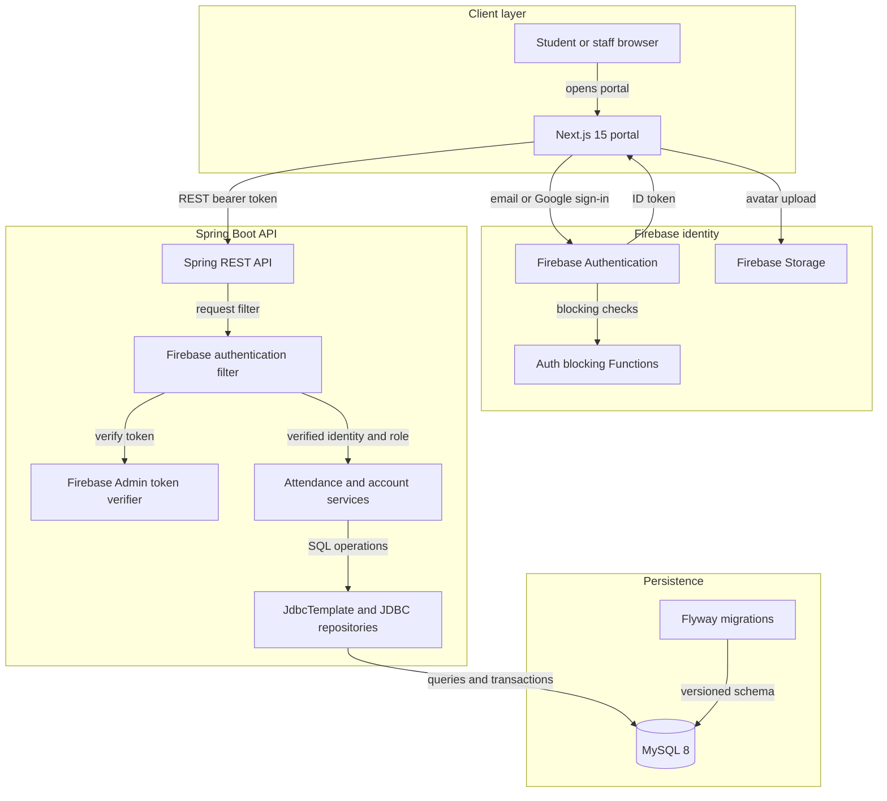
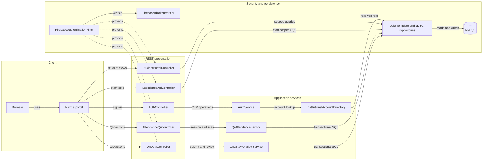

# Architecture Diagram

Attend-IQ V2 contains the original Java attendance CLI and a full-stack web portal over shared MySQL academic data. The portal combines Firebase identity, a Spring Boot API, and a Next.js client.

## Application Architecture

<!-- mermaid-checked: no \n, no em-dash/en-dash, no {} in labels, subgraphs are id["label"], arrows are -->|"label"|, all subgraphs closed by end, ids unique -->

### Technology Stack Summary

| Layer | Technology | Version | Purpose |
|---|---|---:|---|
| Web client | Next.js | 15.5 | Student and staff browser application |
| Web client | React | 19.1 | Interactive interface |
| Web client | TypeScript | 5.8.3 | Typed client code |
| API runtime | Java | 25 | Backend runtime and original CLI |
| API framework | Spring Boot | 3.5.16 | REST, security, JDBC and transaction management |
| Persistence | MySQL | 8.4 local | Relational application data |
| Schema management | Flyway | 11.14.1 | Versioned schema upgrades |
| Identity | Firebase Admin SDK | 9.5.0 | API-side ID-token verification |
| Identity hooks | Firebase Functions | 6.6.0 lockfile | Auth blocking checks |

### Data Storage & External Services

MySQL stores academic records, attendance, workflow state and audit events. Firebase Authentication manages sign-in identities, while Firebase Storage holds profile media. The local Compose stack can use Firebase emulators; the production configuration targets Firebase Hosting, Cloud Run and Cloud SQL. No application-level cache or message broker was identified.

### Key Architectural Decisions

- The web API uses `JdbcTemplate` and explicit SQL instead of JPA; the existing CLI retains its direct JDBC repositories.
- Firebase ID-token claims establish the authenticated identity, while the database account directory supplies the application role and account scope.
- Flyway migrations version the web application schema; the CLI and portal share core academic and attendance tables.

## Component Relationships

<!-- mermaid-checked: no \n, no em-dash/en-dash, no {} in labels, subgraphs are id["label"], arrows are -->|"label"|, all subgraphs closed by end, ids unique -->

### Component Inventory

| Component | Layer | Type | Responsibility |
|---|---|---|---|
| `web/` | Client | Next.js application | Student and staff user interface |
| `AuthController` | Presentation | Spring REST controller | API-side OTP request and verification flows |
| `StudentPortalController` | Presentation | Spring REST controller | Student profile, dashboard, history and audit queries |
| `AttendanceApiController` | Presentation | Spring REST controller | Staff course, student, session, roster and attendance operations |
| `AttendanceQrController` | Presentation | Spring REST controller | QR session and scan request handling |
| `OnDutyController` | Presentation | Spring REST controller | OD request and staff review routes |
| `FirebaseAuthenticationFilter` | Security | Spring filter | Extracts bearer tokens and builds the authenticated principal |
| `FirebaseIdTokenVerifier` | Security | Firebase adapter | Verifies Firebase ID tokens |
| `InstitutionalAccountDirectory` | Business logic | Account service | Resolves database account identity and role |
| `QrAttendanceService` | Business logic | Transactional service | QR sessions, scan validation and expired-session handling |
| `OnDutyWorkflowService` | Business logic | Transactional service | OD/medical request submission and review |
| `JdbcTemplate` | Data access | JDBC helper | Parameterized portal SQL access |
| `AttendanceRepository` | Data access | Legacy JDBC repository | Console attendance reads, writes and audit history |
| Flyway | Infrastructure | Migration runner | Applies versioned database migrations |
