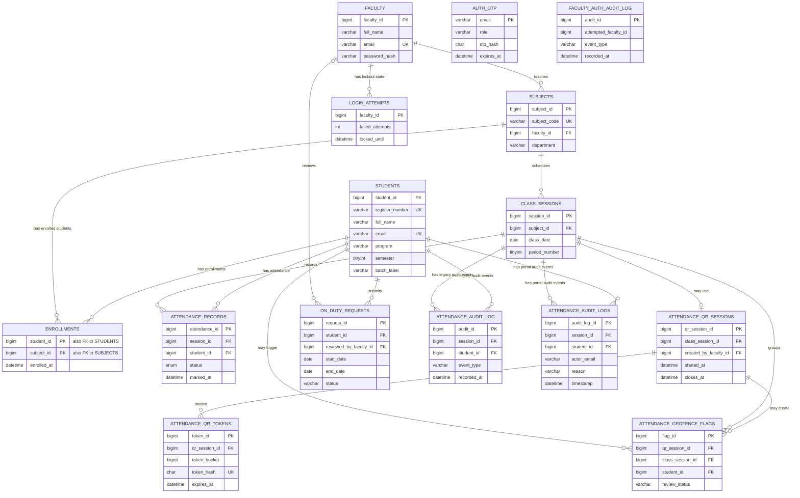

# Data Architecture & Persistence Layer

Attend-IQ V2 stores academic, attendance, identity-mapping, and workflow data in MySQL. The web portal uses parameterized JDBC through `JdbcTemplate`; the legacy Java console uses explicit JDBC repositories, and neither uses JPA entities.

## Database Configuration

| Service/Module | DB Type | Profile | Driver | Connection | Migration Tool |
|---|---|---|---|---|---|
| Spring API | MySQL 8 | Default/local | MySQL Connector/J 9.4.0 | Standard MySQL JDBC connection; HikariCP is Spring Boot's default pool | Flyway 11.14.1 |
| Spring API | MySQL 8 | Production | MySQL Connector/J 9.4.0 and Cloud SQL Connector 1.21.0 | Cloud SQL Connector socket-factory connection | Flyway 11.14.1 |
| Java console | MySQL | Local | MySQL Connector/J | JDBC settings supplied to the console database helper | No independent migration runner |

The application has no alternate HSQLDB, PostgreSQL, or in-memory database profile. Flyway applies `src/main/resources/db/migration/V1__initial_schema.sql` through `V7__generic_demo_account_domains.sql`. Local demo rows are introduced by migration seed scripts and the local portal account seeder; these are not production identity provisioning.

## Data Ownership per Service

| Service | Tables Owned | ORM Framework | Caching | Notes |
|---|---|---|---|---|
| Spring portal API | `students`, `faculty`, `subjects`, `enrollments`, `class_sessions`, `attendance_records`, QR, OD, geofence, authentication and audit tables | None; JDBC and `JdbcTemplate` | None | Owns portal workflows and reads/writes the shared MySQL schema |
| Legacy Java console | Academic catalog, student, enrollment, session, attendance, legacy login and legacy audit tables | None; JDBC repositories | None | Shares the core MySQL tables with the portal |
| Firebase Authentication and Functions | No application MySQL tables | Firebase-managed identity | Firebase-managed | Blocking functions enforce account creation and sign-in policy; Firebase Storage stores avatar objects |

## Entity Model

The schema is managed by SQL migrations rather than ORM entity classes. The web layer maps query results to DTOs and records; the original Java domain types are under `src/main/java/com/attendiq/`.

<!-- mermaid-checked: every attribute is `<type> <name> [<key>] ["<description>"]` with at most one of PK/FK/UK, no \n in descriptions, no {} in descriptions, every relationship label is double-quoted -->

`ENROLLMENTS` is the composite-key join table between students and subjects. It is shown explicitly because it has its own enrollment timestamp and uniqueness rule. `FACULTY_AUTH_AUDIT_LOG.attempted_faculty_id` intentionally has no foreign key so unknown IDs can be audited.

Transactions are managed with Spring `@Transactional` in portal services and controllers; the console attendance repository explicitly opens, commits, and rolls back JDBC transactions. The portal's `attendance_records` uniqueness constraint and row locks support duplicate and concurrent-write protection.

## Key Repository Methods

The portal does not define Spring Data repository interfaces; services and controllers issue parameterized SQL with `JdbcTemplate`. The original console exposes explicit repository contracts.

| Service | Repository | Notable Methods | Purpose |
|---|---|---|---|
| Console attendance | `AttendanceRepository` - `src/main/java/com/attendiq/AttendanceRepository.java` | `isStudentEnrolled(Connection, long, long)`, `findSessionSubject(Connection, long)`, `findBySessionAndStudent(Connection, long, long)`, `listByStudent(long)`, `listBySession(long)`, `listBySubjectAndDates(long, LocalDate, LocalDate)` | Enrollment checks, locked session lookup, duplicate lookup and attendance reports |
| Console attendance | `AttendanceRepository` | `insert(...)`, `updateStatus(...)`, `deleteAttendance(...)`, `auditHistory(long)` | Transactional marking/correction/deletion and audit history |
| Console catalog | `AcademicCatalogRepository` - `src/main/java/com/attendiq/AcademicCatalogRepository.java` | `subjectsForFaculty(long)`, `subjectsForStudent(long)`, `studentsForSubject(long)`, `sessionsForSubjectAndDates(...)` | Course rosters and date-filtered class sessions |
| Console catalog | `AcademicCatalogRepository` | `attendancePercentage(long, long)`, `subjectAttendanceSummaries()`, `shortageReports(int)` | Student attendance calculation and staff shortage reporting |
| Console students | `StudentRepository` - `src/main/java/com/attendiq/StudentRepository.java` | `searchStudents(String)`, `listStudents()`, `findStudent(long)` | Search and retrieve student records |
| Portal QR | `QrAttendanceService` - `src/main/java/com/attendiq/web/QrAttendanceService.java` | `start(...)`, `current(...)`, `scan(...)`, `closeExpiredSessions()` | Session lifecycle, scan processing and lazy expired-session closure |
| Portal OD | `OnDutyWorkflowService` - `src/main/java/com/attendiq/web/OnDutyWorkflowService.java` | `submit(...)`, `ownRequests(...)`, `staffQueue(...)`, `review(...)` | Student requests, staff queue and transactional review |
| Portal analytics | `StudentPortalController` and `AttendanceApiController` | Dashboard, history, audit, defaulter and trend queries | Scoped dashboard/report SQL; controller classes use JDBC directly |

## Caching Strategy

No application-level cache provider or cache annotations were found. Portal results are read from MySQL on request; Firebase manages its own identity and storage infrastructure outside the application's database cache strategy.

## Data Ownership Boundaries

The CLI and portal use a shared MySQL database, not database-per-service. Their ownership boundary is logical: both use the same core student, course, enrollment, session, and attendance tables. Portal-specific QR, OD, geofence, OTP, and portal-audit tables are added to that schema. Firebase Authentication and Storage are separate managed services; Firebase identities are mapped to application accounts by institutional email and records in `students` or `faculty`.

The portal services and controllers perform reads and writes through `JdbcTemplate`; the CLI uses JDBC repository contracts and prepared statements. There is no service-to-service REST data access, CQRS store, or bulk repository gateway. Dashboard aggregation is performed with SQL joins/aggregates and Java calculations in the portal/console application layers.

### Data Classification & Sensitivity

| Entity | Sensitive Fields | Classification (PII/PHI/PCI/None) | Controls in Place |
|---|---|---|---|
| `students` | Name, institutional email, registration number, program, semester and batch | PII and education records | Authenticated account scoping and role checks; no field-level encryption or masking is defined in application schema |
| `faculty` | Name, institutional email, legacy password hash | PII and credential verifier | Firebase is the portal identity provider; nullable legacy hash remains for the CLI. No field-level encryption is defined |
| `attendance_records` | Student ID, attendance status and timestamp | Education records | Access is scoped by student or assigned staff; no field-level encryption or masking is defined |
| `attendance_audit_log` | Student ID, actor/faculty ID, status and reason | PII and education records | Relational access controls and audit association; no field-level encryption is defined |
| `attendance_audit_logs` | Student ID, actor email, IP address, reason and timestamp | PII and education records | Portal authorization and append-oriented write path; no field-level encryption or masking is defined |
| `attendance_qr_sessions` | Classroom coordinates and session timing | Location-sensitive operational data | Session-scoped access; no field-level encryption is defined |
| `attendance_qr_tokens` | Token hash and expiry | Security-sensitive data | Only token hashes are persisted; uniqueness and expiry are enforced |
| `attendance_geofence_flags` | Student ID, distance and GPS accuracy | PII and location-sensitive data | Staff review workflow; no field-level encryption or masking is defined |
| `on_duty_requests` | Student ID, reason and proof metadata | PII and PHI; may reveal medical information | Staff review and student ownership checks; proof is metadata only in this schema; no field-level encryption is defined |
| `auth_otp` | Email and OTP hash | PII and authentication data | Hash, expiry and failed-attempt count are stored instead of a plaintext OTP |
| `faculty_auth_audit_log` | Attempted faculty ID and login event | PII and security audit data | Password-free event data; attempted ID has no foreign key to retain unknown-ID attempts |

No payment-card data was identified in the schema. Database storage encryption depends on the selected MySQL hosting configuration; the application does not implement field-level encryption or masking for the listed fields.
