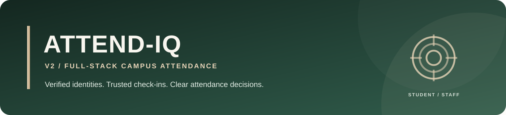
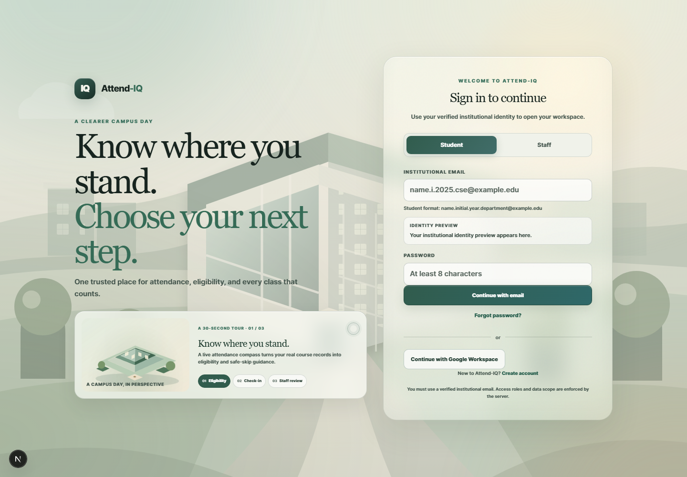
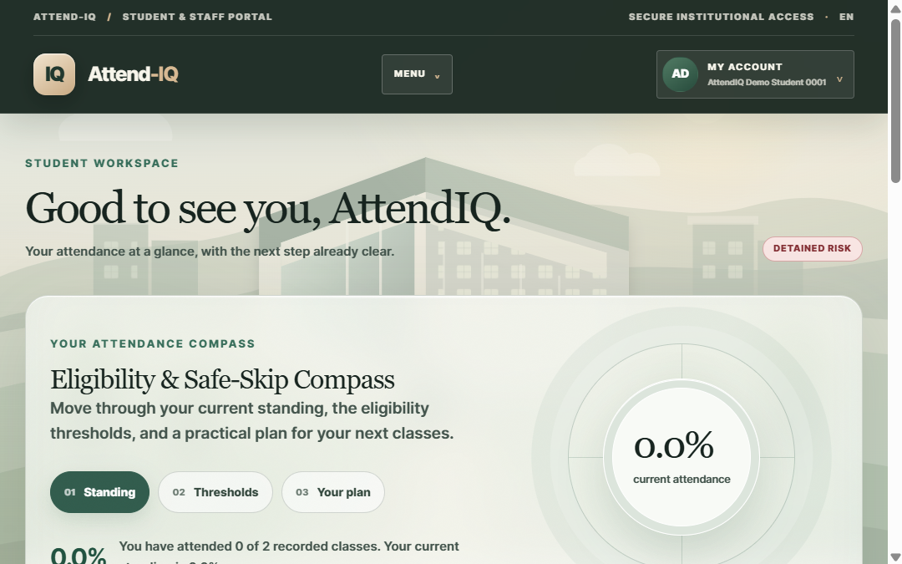
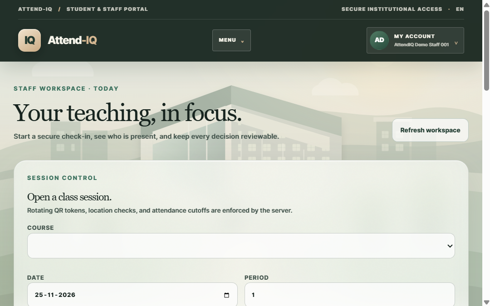
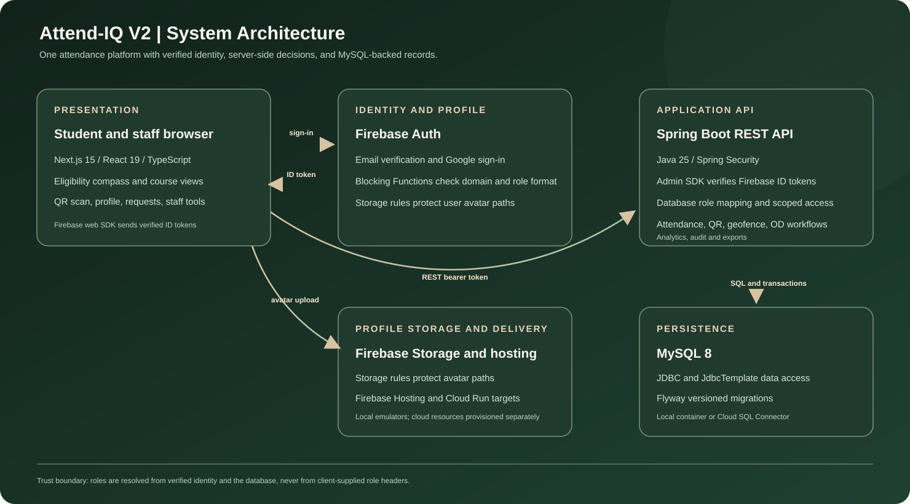
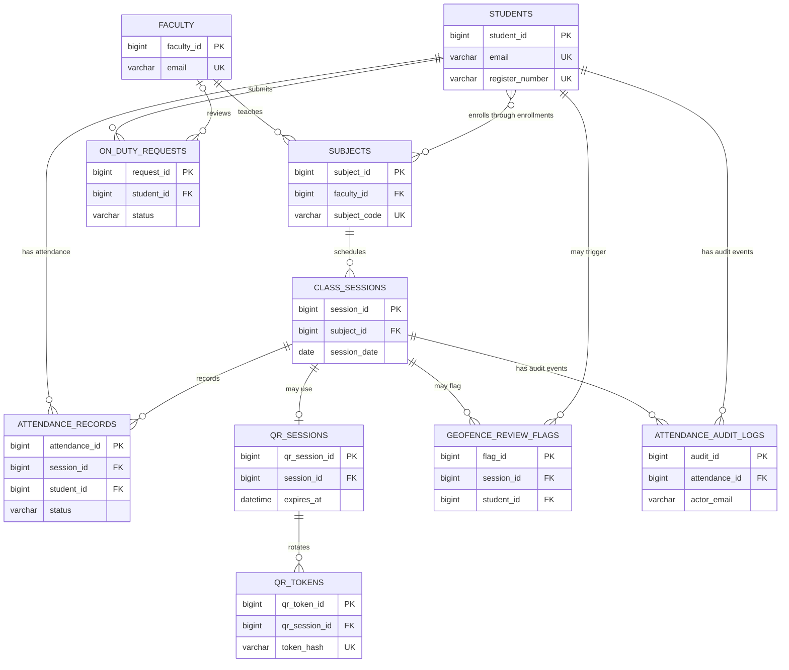

<p align="center">
  
</p>

<p align="center">
  <strong>A full-stack attendance platform for students and staff</strong><br>
  Firebase Authentication · Spring Boot · MySQL · Next.js
</p>

<p align="center">
  <a href="#screenshots">Screenshots</a> ·
  <a href="#features">Features</a> ·
  <a href="#run-locally">Run locally</a> ·
  <a href="#architecture">Architecture</a> ·
  <a href="#documentation">Documentation</a>
</p>

# Attend-IQ V2

Attend-IQ V2 evolves the original Java attendance project into a full-stack web application. It combines institutional Firebase sign-in, a Spring Boot REST API, MySQL persistence, student and staff workspaces, and an editorial Liquid Glass-inspired interface.

> **Project status:** This repository contains the application and deployment configuration. Production Firebase, Cloud Run, and Cloud SQL resources must be provisioned and configured separately; this README does not claim a live production deployment.

## Screenshots

| Authentication | Student workspace |
|---|---|
|  |  |

| Staff workspace |
|---|
|  |

Screenshots were captured from the local demo environment. The staff demo account shown has no assigned courses, so its roster is empty until courses and enrollments are configured.

## Features

- **Institutional authentication:** Firebase Authentication with verified-email and institutional-domain checks, staff/student address-format validation, and Firebase Auth blocking functions.
- **Role-aware access:** Backend authorization derives identity from verified Firebase ID tokens and resolves the role from server-side account data.
- **Attendance workflows:** Staff session controls and QR check-in, student attendance views, OD/medical request handling, and audit records.
- **Anti-proxy controls:** Time-limited rotating QR tokens, server-side geofence checks, GPS accuracy checks, duplicate-scan constraints, and reviewable geofence flags.
- **Student eligibility tools:** Attendance summaries, eligibility/condonation bands, and safe-skip calculations.
- **Persistent data:** MySQL schema managed with Flyway migrations; local development can use Docker Compose.
- **Responsive interface:** Next.js, TypeScript, and a glass-inspired visual system with accessibility fallbacks.
- **Deployment configuration:** Firebase Hosting and Cloud Run / Cloud SQL configuration are included; cloud resources and secrets remain operator-provisioned.

## Technology

| Area | Technologies |
|---|---|
| Frontend | Next.js 15, React 19, TypeScript, Tailwind CSS |
| API | Java 25, Spring Boot 3.5, Spring Security, JDBC |
| Database | MySQL 8.4, Flyway |
| Identity | Firebase Authentication, Firebase Admin SDK, Firebase Functions |
| Local development | Docker Compose, Firebase Emulator Suite |
| Production targets | Firebase Hosting, Cloud Run, Cloud SQL for MySQL |

## Run locally

### Prerequisites

- Java 25 and Maven
- Node.js 22 and npm
- Docker Desktop with Docker Compose
- Firebase CLI for emulator workflows

### Start the local stack

1. Copy the example environment file and fill in local-only values. Do not commit credentials or service-account keys.

   ```powershell
   Copy-Item .env.example .env
   ```

2. Start the services:

   ```powershell
   docker compose up --build
   ```

3. Open the web application at `http://localhost:3000`. With the supplied `.env.example`, the API is available at `http://localhost:8082` and MySQL at `localhost:3308`. Without those overrides, Compose maps MySQL to port `3306`.

The example configuration uses the generic `example.edu` domain and placeholder coordinates. Set `ALLOWED_EMAIL_DOMAIN`, `NEXT_PUBLIC_ALLOWED_EMAIL_DOMAIN`, `CAMPUS_LAT`, and `CAMPUS_LNG` for your deployment. Flyway V7 aligns seeded demo-account addresses with the configured domain; the previously applied V5 migration remains unchanged to preserve database history. Use the Firebase Emulator Suite for local authentication and Functions testing. Keep `DEV_AUTH_BYPASS` disabled unless you are intentionally running an isolated local test configuration; it must remain disabled in production.

### Run checks without Docker Compose

```powershell
mvn clean verify
Push-Location web
npm ci
npm run build
Pop-Location
```

The backend integration tests require the configured MySQL test database. Run `npm ci` once when setting up the frontend dependencies.

## Architecture



The browser uses Firebase Authentication for sign-in and sends Firebase ID tokens to the Spring Boot API. The API verifies tokens with Firebase Admin, performs authorization and attendance operations against MySQL, and serves the frontend's data. Profile media uses Firebase Storage. Local emulator and production deployment details depend on the environment configuration.

### Core data model

<!-- mermaid-checked: every attribute is `<type> <name> [<key>] ["<description>"]` with at most one of PK/FK/UK, no \n in descriptions, no {} in descriptions, every relationship label is double-quoted -->


The diagram is a high-level view; see the migration scripts and database documentation for the authoritative columns and constraints.

## Deployment

The repository includes configuration for Firebase Hosting, Cloud Run, and Cloud SQL for MySQL. Before deploying, provision the cloud resources, configure Firebase project identifiers and secrets, set the production database connection, and ensure the authentication bypass is disabled. Cloud resources are not provisioned by this repository.

## Documentation

- [Application architecture](docs/ARCHITECTURE.md)
- [Database schema and migrations](docs/DATABASE_SCHEMA.md)
- [Testing notes](docs/TESTING.md)
- [Detailed architecture diagrams](.github/modernize/assessment/engines/facts/architecture-diagram.md)
- [Data architecture and persistence](.github/modernize/assessment/engines/facts/data-architecture.md)

## Security notes

- Never commit `.env` files, Firebase service-account credentials, signing keys, or production secrets.
- Production requests must use verified Firebase ID tokens; client-provided role claims are not authoritative.
- Use the Firebase Emulator Suite for local identity testing and keep development bypasses disabled in production.
- Configure and review the allowed institutional domain and account-format rules for your deployment.
