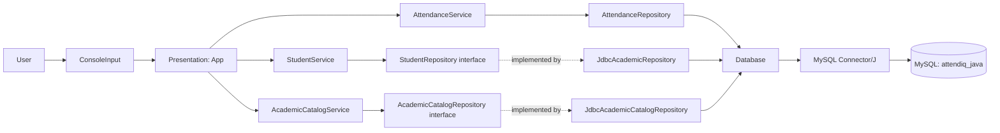
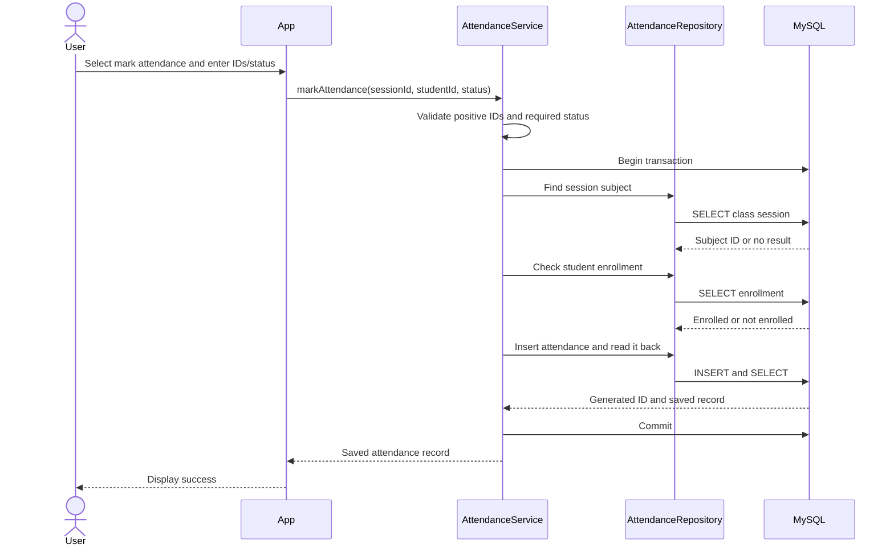
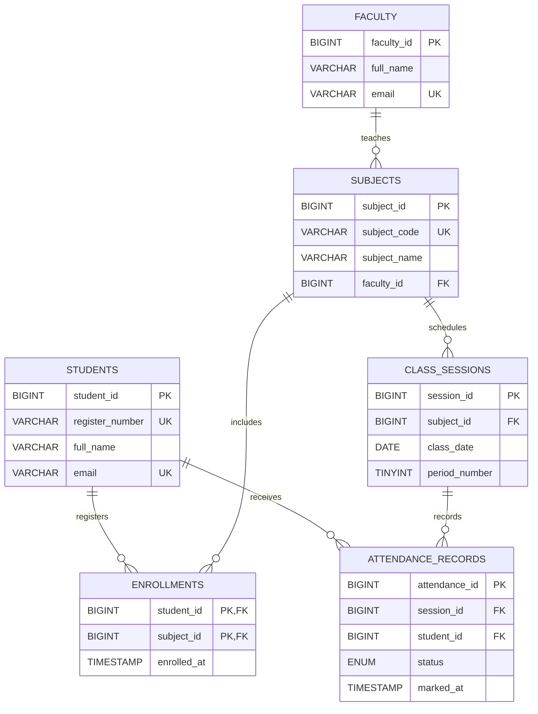

# AttendIQ Java Attendance

A polished console-based academic attendance system built with Java 25, JDBC, and MySQL. It includes a live dashboard, ANSI-aware paginated tables, CRUD management for students/faculty/subjects/enrollments/sessions, single and bulk attendance, corrections with transactional audit history, reports, and safe CSV exports. It remains a standard-library console app; no frontend or GUI is included.

**Problem:** manual attendance is difficult to validate consistently and can produce duplicate or untraceable marks. **Objective:** demonstrate a clear Java OOP/JDBC workflow that checks the session and enrollment, commits a single attendance record, and reports attendance from persisted MySQL data.

## Technology Stack

| Area | Technology |
| --- | --- |
| Application language | Java 25 LTS |
| Database language | SQL |
| Database | MySQL 8 or newer |
| Database access | JDBC with MySQL Connector/J 9.4.0 |
| Build | Apache Maven 3.9 or newer |
| Command shell examples | Windows PowerShell |

The project targets Java 25 through `maven.compiler.release`. VS Code with the Extension Pack for Java is optional.

## Architecture

`ConsoleUI`/`ConsoleTable` render menus, panels, colors, and paginated tables. `App` gathers input and delegates to service classes. Services validate requests and coordinate transactions; repository interfaces separate use cases from JDBC implementations. Repositories execute parameterized SQL, and `Database` owns environment-based connection configuration.



### Mark Attendance Flow



If validation or a database operation fails, the service rolls back the transaction. MySQL also enforces a unique `(session_id, student_id)` pair, preventing duplicate marks for a session.

## Data Model



`ENROLLMENTS` uses `(student_id, subject_id)` as a composite primary key. A class session is unique per subject, date, and period. Attendance status is restricted to `PRESENT`, `ABSENT`, or `ON_DUTY`.

V3 adds `attendance_audit_log`, which records successful attendance marks, corrections, and deletions in the same transaction as the attendance operation. Correction/deletion rows include previous and new statuses, reason, and the **claimed** faculty ID. The console does not authenticate that ID. Failed attempts and general catalog CRUD are not audit-logged.

## CRUD Operations

CRUD means Create, Read, Update, and Delete. This table describes operations available in the Java application, not just tables present in the schema.

| Entity | Create | Read | Update | Delete |
| --- | --- | --- | --- | --- |
| Student | Yes | By ID, list, search by name/registration prefix | Yes | Only without enrollment or attendance history |
| Faculty | Yes | List and by ID | Yes | MySQL foreign keys reject deletion while assigned subjects exist |
| Subject | Yes, with assigned faculty | List and by ID | Yes | Only without enrollment or sessions |
| Enrollment | Yes | List, subjects by student, students by subject | N/A; change by remove and re-enroll, only with no attendance history | Yes, only without attendance history |
| Class session | Yes | List, by ID, and by subject/date range | Yes, only before attendance is recorded | Yes, only without attendance history |
| Attendance | Mark Present, Absent, or On-duty | By session/student, by student, by session, or subject/date range | Assigned faculty may correct status; reason required | Assigned faculty may delete a record; reason required |

Attendance update/delete checks that the supplied faculty ID is assigned to the session's subject and locks the session during the operation. This is an academic console authorization check, not authenticated identity: a production system would require login and role enforcement.

## Project Layout

```text
java-attendance/
|-- pom.xml
|-- README.md
|-- src/
|   |-- main/java/com/attendiq/   # console UI, services, domain records, JDBC repositories
|   |-- main/resources/schema.sql
|   |-- test/java/com/attendiq/   # unit and opt-in MySQL integration tests
|   `-- test/resources/schema-test.sql
|-- database/migrations/          # V2 indexes and V3 attendance audit history
|-- exports/                      # CSV output, ignored by Git
|-- docs/                        # architecture, schema, testing, report, demo, viva
`-- pom.xml, README.md, .gitignore
```

## Requirements

- JDK 25 or newer
- Maven 3.9 or newer
- MySQL 8 or newer
- MySQL Workbench (optional; used below to run the schema script)

## Setup and Run (Windows PowerShell)

### 1. Create the schema and demo records

In MySQL Workbench, open `src/main/resources/schema.sql` and execute the script. It creates the `attendiq_java` database, seven application tables plus `schema_migrations`, and demo records:

| Record | Demo ID/value |
| --- | --- |
| Student | ID `1`, register number `REC26CS001` |
| Faculty | ID `1` |
| Subject | ID `1`, code `CS23333` |
| Enrollment | Student `1` in subject `1` |
| Class session | ID `1`, current date, period `1` |

If those IDs already belong to different records, use a fresh development database or adjust the demo data before testing.

### 2. Set Java, Maven, and database settings

Run these commands in the PowerShell terminal from which you will launch Maven. Replace the database password locally; do not commit it or paste it into chat.

```powershell
Set-Location "$HOME\Downloads\AttendIQ-java-attendance-starter\java-attendance"
$env:JAVA_HOME = 'C:\Program Files\Java\jdk-25.0.4.1'
$env:Path = "$env:JAVA_HOME\bin;$HOME\.maven\maven-3.9.15\bin;$env:Path"

$env:ATTENDIQ_DB_URL = 'jdbc:mysql://localhost:3306/attendiq_java?useSSL=false&allowPublicKeyRetrieval=true&serverTimezone=UTC'
$env:ATTENDIQ_DB_USER = 'root'
$env:ATTENDIQ_DB_PASSWORD = 'YOUR_MYSQL_PASSWORD'
$env:ATTENDIQ_ATTENDANCE_TARGET = '75'
$env:ATTENDIQ_COLOR = 'always' # use 'never' for plain output; omit for auto-detection
```

The `allowPublicKeyRetrieval=true` URL option is included for local development with non-TLS MySQL authentication. Prefer TLS with certificate verification for remote or production database connections. If the MySQL account has no password, set `ATTENDIQ_DB_PASSWORD` to an empty string.

These environment variables apply only to the current PowerShell session. Set them again in a new terminal.

### 3. Build and launch

```powershell
mvn clean verify
mvn exec:java
```

The root menu is: 1 Dashboard, 2 Students, 3 Faculty, 4 Subjects, 5 Enrollments, 6 Class sessions, 7 Attendance, 8 Reports, 9 CSV exports, 10 System/Database, 11 Help, 12 Exit. Submenus use `0` to return. Colors are enabled in Windows Terminal/VS Code terminals when supported; `NO_COLOR=1` or `ATTENDIQ_COLOR=never` disables ANSI colors, while `ATTENDIQ_COLOR=always` forces them.

CRUD submenus provide the applicable list/view/create/update/delete actions. Attendance corrections and deletion require a faculty ID assigned to the session's subject. The demo uses student `1`, subject `1`, faculty `1`, and session `1`. Tables show 12 rows per page; press Enter for the next page or `q` to stop.

Duplicate marks are rejected by the database unique constraint. Bulk marking previews the actual roster, skips existing marks, and reports saved/skipped/failed rows; each accepted row commits independently and never silently overwrites. Deletes that would erase attendance/audit history are refused.

Run `schema.sql` for a fresh database; it uses `CREATE TABLE IF NOT EXISTS` and `INSERT IGNORE`, and does not drop tables or reset data. For an existing V1 database, back it up, then apply `database/migrations/V2__student_name_search_index.sql` followed by `database/migrations/V3__attendance_audit_log.sql`. Both are safe to rerun. The System menu never runs migrations or modifies the database automatically.

## Attendance Reports

For one student and subject, the report counts scheduled sessions from the enrollment date through today. `PRESENT` and `ON_DUTY` count as attended; `ABSENT` and unmarked sessions do not count as attended. Unmarked sessions are reported separately and are included in the denominator, so the policy is visible rather than silently treating missing records as explicit absences.

$$
P = 100 \times \frac{p + o}{s}
$$

Here, $p$ is the Present count, $o$ is the On-duty count, and $s$ is scheduled sessions.

With zero scheduled sessions, the calculation returns `0%` and the console reports that no sessions are available. The shortage forecast computes the minimum number of consecutive attended sessions `x` satisfying $(A+x)/(T+x) \ge target/100$, where $A$ is attended and $T$ is scheduled. The default target is 75%; set `ATTENDIQ_ATTENDANCE_TARGET` to an integer from 1 to 100. For a 100% target after a missed session, the result is unreachable.

Dashboard totals are fetched from MySQL on each visit. Today's rate is `(Present + On-duty) / enrolled roster entries expected today`; the below-target statistic counts enrolled student/subject pairs below the configured threshold. Recent activity comes from persisted attendance audit rows. A fresh database displays an honest empty state.

## Bulk, Audit, and Export

- Bulk marking displays the enrolled roster and existing attendance, collects statuses for unmarked students, previews changes, and asks for confirmation. Each row commits independently through `AttendanceService`; partial results are reported and existing attendance is never overwritten.
- CSV export supports students, attendance filtered by student/session/subject date range, subject summaries, and shortages. Files are UTF-8 with quoted/escaped fields. The default destination is `exports/`, which is ignored by Git. Existing files require explicit overwrite confirmation.
- V3 records successful attendance marks, corrections, and deletions in the same transaction. Correction/deletion entries include previous/new status, reason, and `claimed_faculty_id`. That ID is user-entered and is not authenticated. Failed attempts and catalog CRUD are not audit-logged; this is not a fraud detector.
- The System menu tests a real JDBC connection and shows Java/MySQL versions, database name, and last successful in-process connection check without showing credentials.

## OOP Structure

- **Encapsulation and composition:** services keep their repository collaborators in private final fields; `App` composes input, services, and repositories.
- **Abstraction and polymorphism:** `StudentRepository` and `AcademicCatalogRepository` are contracts implemented by JDBC classes, allowing services to use interfaces.
- **Records and enums:** immutable data records represent entities/results; `AttendanceStatus` restricts allowed status values.
- **Inheritance:** no artificial inheritance hierarchy is used because the current domain has no justified is-a relationship.
- **Transactions:** attendance marking, authorized correction/deletion, and protected catalog deletion commit as a unit and roll back on failure.

## Validation and Security Notes

- `mvn clean test` runs unit tests for validation, attendance math, console rendering/input, bulk result handling, and CSV output. The MySQL integration test is disabled unless `ATTENDIQ_RUN_MYSQL_IT=true` and uses a database whose name ends in `_test`.
- To run the integration test, execute `src/test/resources/schema-test.sql` in MySQL Workbench. It creates the separate `attendiq_java_test` database without demo records. Set `ATTENDIQ_DB_URL` to that database, set the usual user/password variables, then run `$env:ATTENDIQ_RUN_MYSQL_IT = 'true'; mvn -Dtest=AttendanceMySqlIntegrationTest test`. Never point integration tests at `attendiq_java` or a production/personal database.
- `mvn clean verify` compiles production and test code and runs the default test suite.
- JDBC statements use `PreparedStatement` parameters rather than interpolating user values into SQL.
- Database credentials are read from environment variables by `Database`; never hard-code or commit real credentials.
- This is a college console application, not a production-ready identity system. Faculty correction checks rely on an entered faculty ID and do not authenticate the person. It has no login, role sessions, GUI, or automated MySQL integration run by default.

Latest recorded test result: **14 unit tests passed, 0 failed; 1 opt-in MySQL integration test skipped**. The tests are documented in [docs/TESTING.md](docs/TESTING.md). The integration test was not run against the local attendance database.

## Project and Viva Documents

- [Architecture and OOP design](docs/ARCHITECTURE.md)
- [Database tables, relationships, and migrations](docs/DATABASE_SCHEMA.md)
- [Testing commands and integration-test safety](docs/TESTING.md)
- [Academic project report](docs/PROJECT_REPORT.md)
- [Faculty demonstration walkthrough](docs/DEMO_SCRIPT.md)
- [Viva questions and answers](docs/VIVA_QUESTIONS.md)

## Troubleshooting

- **`Public Key Retrieval is not allowed`**: for local non-TLS development, confirm the JDBC URL includes `allowPublicKeyRetrieval=true`. For production, configure TLS instead.
- **`Access denied for user`**: confirm MySQL is running and that `ATTENDIQ_DB_USER` and `ATTENDIQ_DB_PASSWORD` match the MySQL account. Workbench does not normally reveal a saved password; reset the account if it is forgotten.
- **Session or student not found / not enrolled**: run the demo SQL and verify the selected IDs and enrollment in the `attendiq_java` database.

## Concepts Demonstrated

- Separation of concerns between console UI, service, repository, and database connection management.
- Validation and transaction rollback in the service layer.
- `AttendanceStatus` enum and immutable `AttendanceRecord` record.
- JDBC connections, prepared statements, result sets, and generated keys.
- Relational primary keys, foreign keys, composite keys, check constraints, and uniqueness constraints.
