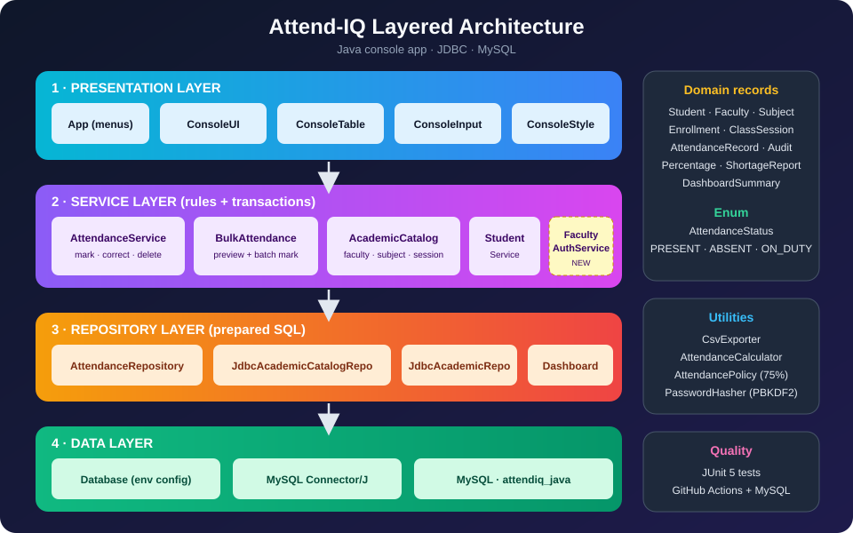
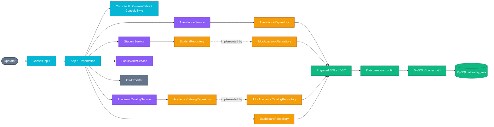
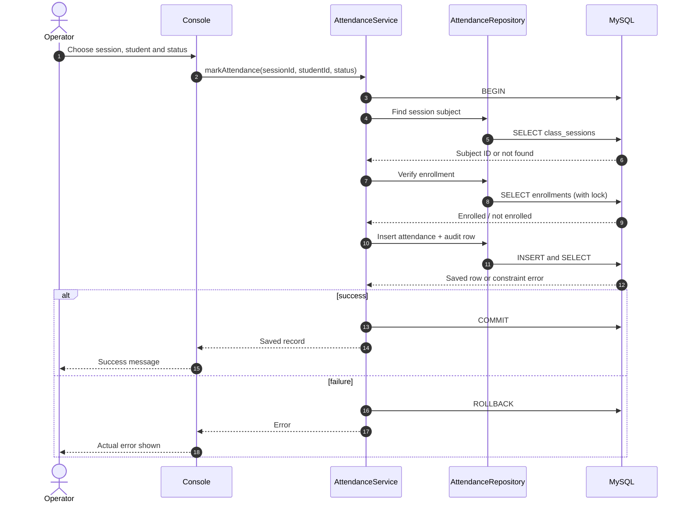
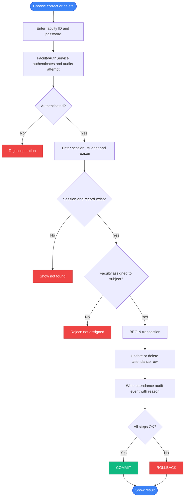
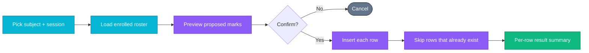
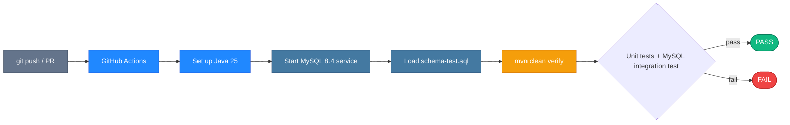
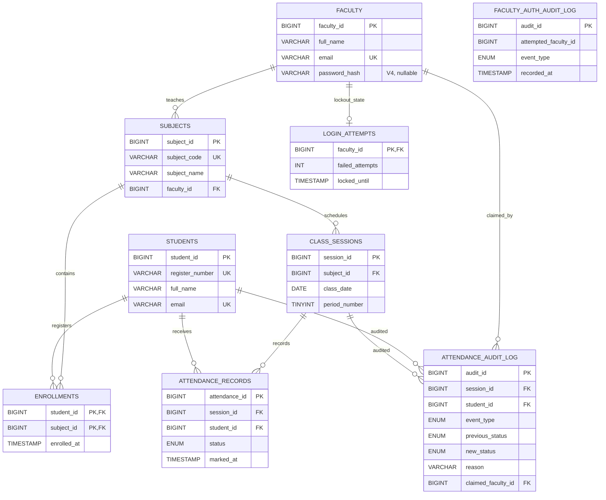

<div align="center">


# Attend-IQ

### Smart Attendance Management System: Java | JDBC | MySQL

*A database-backed console application with colored terminal navigation, attendance reports, audit history and CSV export.*

<br>


<br><br>

<a href="https://github.com/vishweshwaranbalasundaram/Attend-IQ/actions/workflows/verify.yml"></a>

</div>

---

## Quick Navigation

| Start | Understand | Learn | Work on it |
| :-- | :-- | :-- | :-- |
| [Quick Start](#quick-start) | [Architecture](#architecture) | [User guide](docs/USER_GUIDE.md) | [Testing](#testing--ci) |
| [Features](#features) | [Workflows](#workflows) | [Project report](docs/PROJECT_REPORT.md) | [Roadmap](#roadmap) |
| [Main menu](#main-menu) | [Database ER](#database-er-diagram) | [Viva questions](docs/VIVA_QUESTIONS.md) | [Contributing](#contributing) |
| [Full setup](#full-setup) | [Attendance policy](#attendance-calculation-policy) | [Demo script](docs/DEMO_SCRIPT.md) | [Limitations](#known-limitations) |

---

## Why Attend-IQ?

Manual attendance is slow to reconcile and easy to get wrong: duplicate marks, marks for students who are not enrolled, and no history of corrections. Attend-IQ models the whole workflow in a relational database and **validates the class session and enrollment before saving anything**.

| Goal | How it is done |
| :-- | :-- |
| No duplicate attendance | `UNIQUE (session_id, student_id)` in MySQL, also under concurrent attempts |
| Only enrolled students | Service checks enrollment inside a transaction |
| Traceable corrections | Audit log for marks, corrections and deletions |
| Know who is at risk | Percentage, shortage forecast and below-target dashboard |
| Easy sharing | CSV export for students, attendance, summaries and shortage reports |

---

## Quick Start

```bash
# 1) Clone
git clone https://github.com/vishweshwaranbalasundaram/Attend-IQ.git
cd Attend-IQ

# 2) Create the database (run in MySQL Workbench or the mysql client)
mysql -u root -p < src/main/resources/schema.sql

# 3) Configure (Linux/macOS shell; Windows PowerShell version is in Full Setup)
export ATTENDIQ_DB_URL='jdbc:mysql://localhost:3306/attendiq_java?useSSL=false&allowPublicKeyRetrieval=true&serverTimezone=UTC'
export ATTENDIQ_DB_USER='root'
export ATTENDIQ_DB_PASSWORD='YOUR_MYSQL_PASSWORD'

# 4) Test and run
mvn clean verify
mvn exec:java
```

> Never commit your database password. It is read from environment variables only and is never printed.

---

## Features

| Module | What you can do |
| :-- | :-- |
| `[ST]` **Students** | Create, list, view, update, delete (when history permits), search by name or register-number prefix |
| `[FC]` **Faculty** | Create, list, view, update, delete (subject to foreign keys), list assigned subjects |
| `[SB]` **Subjects** | Create, list, view, update, delete when enrollment/session history permits |
| `[EN]` **Enrollments** | Enroll or remove students, list by student or subject |
| `[CS]` **Class sessions** | Create, list, view, update/delete before attendance exists, filter by subject/date range |
| `[AT]` **Attendance** | Mark `PRESENT`, `ABSENT` or `ON_DUTY`; view by session, student or subject/date range |
| `[BA]` **Bulk attendance** | Preview roster and proposed marks, skip existing rows, per-row results |
| `[ED]` **Corrections** | Correct or delete with a reason and assigned-faculty check; audit event kept |
| `[RP]` **Reports** | Student/subject percentage, subject summaries, shortage forecast, history filters |
| `[DB]` **Dashboard** | Totals from MySQL, today's roster status, below-target count, recent audit activity |
| `[CSV]` **CSV export** | Students, filtered attendance, subject summaries, shortage reports (overwrite confirmation) |
| `[SYS]` **Diagnostics** | Test the JDBC connection and view Java/database info without showing credentials |
| `[UI]` **Console UI** | ANSI colors (with no-color option), panels, pagination, progress bars |

### Console Preview

> Illustrative terminal mockup with placeholder values, not a screenshot of a live session.

<p align="center">
  
</p>

---

## Technology Stack

<div align="center">

| Tag | Technology | Role |
| :-- | :-- | :-- |
| `[JAVA]` | **Java 25** | Console app, services, domain records, validation, transactions |
| `[DB]` | **MySQL 8+** | Relational storage, keys, constraints, attendance history |
| `[JDBC]` | **JDBC / Connector/J 9.4.0** | Prepared statements, transactions, generated keys |
| `[BUILD]` | **Apache Maven 3.9+** | Build, dependencies, test, run |
| `[TEST]` | **JUnit 5.11.4** | Unit tests and opt-in MySQL integration test |
| `[CI]` | **GitHub Actions** | Build and test on push, pull request and manual run |

</div>

> Badges describe the configured stack, not a measured source-code language percentage.

---

## Architecture

<p align="center">
  
</p>

The same design as a dependency diagram:



**Layer rules**
- **[UI] Presentation** (`App`, console helpers) collects input and renders output.
- **[SVC] Services** enforce use-case rules and coordinate multi-step transactions.
- **[REPO] Repositories** define persistence operations; JDBC classes own the SQL.
- **[DB] Database** reads connection settings from environment variables.

---

## Workflows

### Attendance marking



### Correction / delete flow



### Bulk attendance



### Build and CI pipeline



> The workflow file includes a MySQL service so the integration test can run in CI. No remote result is claimed until GitHub records a run.

---

## Database ER Diagram



`ENROLLMENTS` has a composite `(student_id, subject_id)` key. Sessions are unique per subject/date/period; attendance is unique per session/student. `FACULTY_AUTH_AUDIT_LOG` deliberately has no foreign key so failed attempts for unknown faculty IDs can be recorded. Full details: [DATABASE_SCHEMA.md](docs/DATABASE_SCHEMA.md).

---

## Database Integrity and Security

| Protection | Detail |
| :-- | :-- |
| SQL injection | Values bound with `PreparedStatement`; resources closed with try-with-resources |
| Integrity | Primary/foreign/composite keys, unique identifiers, schedule and attendance uniqueness |
| Transactions | Marking and audited corrections/deletions commit or roll back as one unit |
| Safe deletes | Enrollment and attendance history blocks unsafe deletion; the app never drops or resets data |
| Credentials | `ATTENDIQ_DB_URL`, `ATTENDIQ_DB_USER`, `ATTENDIQ_DB_PASSWORD`; password never printed |
| Password hashing (new) | `PasswordHasher`: PBKDF2-HMAC-SHA256, 210,000 iterations, random salt, constant-time compare |
| Audit | Attendance changes use V3; password-free login success/failure/lockout events use V5 |

> Attendance correction and deletion now require the assigned faculty ID and a verified password. Passwords are salted PBKDF2 hashes; login failures are rate-limited and recorded without passwords.

---

## Project Structure

```text
Attend-IQ/
|-- .github/workflows/verify.yml      # CI: Java 25 + MySQL service + mvn verify
|-- database/migrations/              # V2 search index through V5 login security
|-- docs/                             # architecture, schema, user, testing, report, viva
|   \-- assets/                       # banner, console preview, architecture SVG
|-- src/main/java/com/attendiq/       # console, services, domain, JDBC repositories
|-- src/main/resources/schema.sql     # fresh-install schema + demo rows
|-- src/test/java/com/attendiq/       # unit tests + opt-in MySQL integration test
|-- src/test/resources/schema-test.sql
|-- pom.xml
\-- README.md
```

---

## Full Setup

**Prerequisites:** JDK 25+, Apache Maven 3.9+, MySQL 8+, MySQL Workbench (optional).

<details>
<summary><b>1. Prepare the database</b></summary>

For a fresh database, execute `src/main/resources/schema.sql`. It creates `attendiq_java`, the tables, migration tracking and optional demo rows using `CREATE TABLE IF NOT EXISTS` and `INSERT IGNORE`. It does not drop tables or reset rows.

For an existing database, **back it up first**, then apply in order:

1. `database/migrations/V2__student_name_search_index.sql`
2. `database/migrations/V3__attendance_audit_log.sql`
3. `database/migrations/V4__faculty_password_hash.sql`
4. `database/migrations/V5__faculty_login_lockout_and_audit.sql`

The System menu never runs migrations automatically.
</details>

<details>
<summary><b>2. Configure (Windows PowerShell)</b></summary>

```powershell
Set-Location "$HOME\Downloads\AttendIQ-java-attendance-starter\java-attendance"
$env:JAVA_HOME = 'C:\Program Files\Java\jdk-25.0.4.1'
$env:Path = "$env:JAVA_HOME\bin;$HOME\.maven\maven-3.9.15\bin;$env:Path"

$env:ATTENDIQ_DB_URL = 'jdbc:mysql://localhost:3306/attendiq_java?useSSL=false&allowPublicKeyRetrieval=true&serverTimezone=UTC'
$env:ATTENDIQ_DB_USER = 'root'
$env:ATTENDIQ_DB_PASSWORD = 'YOUR_MYSQL_PASSWORD'
$env:ATTENDIQ_ATTENDANCE_TARGET = '75'
$env:ATTENDIQ_COLOR = 'always'   # 'never' for plain output; omit for auto
```

`allowPublicKeyRetrieval=true` is for local development. Prefer TLS with certificate verification for remote or production databases. Variables apply only to the current PowerShell session.
</details>

<details>
<summary><b>3. Environment variables</b></summary>

| Variable | Purpose | Default |
| :-- | :-- | :-- |
| `ATTENDIQ_DB_URL` | JDBC URL | `jdbc:mysql://localhost:3306/attendiq_java?useSSL=false&serverTimezone=UTC` |
| `ATTENDIQ_DB_USER` | MySQL user | `root` |
| `ATTENDIQ_DB_PASSWORD` | MySQL password | empty |
| `ATTENDIQ_ATTENDANCE_TARGET` | Target percentage, integer 1 to 100 | `75` |
| `ATTENDIQ_COLOR` | `always` / `never` (also honors `NO_COLOR=1`) | auto |
| `ATTENDIQ_RUN_MYSQL_IT` | `true` enables the MySQL integration test | off |
</details>

```powershell
mvn clean verify     # compile + run the default test suite
mvn exec:java        # start com.attendiq.App
```

---

## Main Menu

| Key | Module | Key | Module |
| :-: | :-- | :-: | :-- |
| `1` | `[DB]` Dashboard and quick actions | `7` | `[AT]` Attendance (bulk marking, correction) |
| `2` | `[ST]` Student Management | `8` | `[RP]` Reports & Analytics |
| `3` | `[FC]` Faculty Management | `9` | `[CSV]` CSV exports |
| `4` | `[SB]` Subject Management | `10` | `[SYS]` System & Database diagnostics |
| `5` | `[EN]` Enrollment Management | `11` | `[?]` Help & Shortcuts |
| `6` | `[CS]` Class Session Management | `0` | `[X]` Exit (`12` also accepted) |

Submenus use `0` to go back. Tables show 12 rows per page: press Enter for the next page or `q` to stop.

---

## Attendance Calculation Policy

`PRESENT` and `ON_DUTY` count as attended. `ABSENT` and **unmarked** scheduled sessions do not count, and unmarked sessions stay in the denominator.

```text
percentage = 100 × (present + on-duty) / scheduled sessions
```

- No scheduled sessions → `0%` with an explanation.
- **Shortage forecast:** the smallest `x` where `(attended + x) / (scheduled + x) ≥ target / 100`. If the target is 100% and an absence already exists, it is unreachable.
- **Dashboard:** totals come from MySQL. Today's rate = attended marks ÷ roster expected today. Below-target counts enrolled student/subject pairs under the threshold.

---

## Testing & CI

| Covered | Notes |
| :-- | :-- |
| Service validation, attendance calculations | Unit tests |
| Console input and rendering, CSV escaping/overwrite, bulk results | Unit tests |
| Password hashing and fake-clock lockout policy | Unit tests |
| MySQL persistence and faculty authentication | Opt-in `AttendanceMySqlIntegrationTest` and `FacultyAuthServiceIntegrationTest` |

**Local result (2026-10-20):** `mvn clean verify` with MySQL 8.4 and `ATTENDIQ_RUN_MYSQL_IT=true` completed 45 tests, 0 failures, 0 errors, 0 skipped. JaCoCo reported 92.7% aggregate line coverage across service classes. This is a local result; GitHub Actions has not yet been run.

The MySQL integration tests require a dedicated database whose name ends with `_test`, created from `src/test/resources/schema-test.sql`. Never point them at a personal or production database.

---

## Roadmap

| Status | Item |
| :-: | :-- |
| DONE | Console CRUD, attendance, bulk marking, corrections, audit, reports, CSV export |
| DONE | PBKDF2 `PasswordHasher`, `FacultyAuthService`, V4 `password_hash` column |
| DONE | CI workflow with MySQL service for the integration test |
| DONE | Wire faculty password login into `App` for correction/delete |
| DONE | Set/change faculty password menu option |
| DONE | Login attempt tracking and temporary lockout (V5) |
| DONE | JaCoCo report and 70% service coverage target in CI |
| DONE | `docker-compose.yml` with MySQL only and schema initialization |

---

## Known Limitations

- The console uses local faculty passwords, not a centralized identity provider.
- Login attempts are audited separately; catalog changes and failed attendance authorization attempts are not audited.
- Local integration tests need a separate `_test` database; CI creates one automatically.
- Local console program only: no hosted service, web API or frontend.
- No automatic schema migration runner; apply migrations manually after a backup.

---

## Learning Outcomes

| Area | What it demonstrates |
| :-- | :-- |
| **OOP** | Encapsulation and composition in services, repository interfaces with polymorphic implementations, records and enums |
| **DBMS** | Normalized relations, primary/foreign/composite keys, uniqueness, referential integrity |
| **JDBC** | Connections, prepared statements, result sets, generated keys, commit and rollback |
| **Design** | Layered responsibilities, validation, exception handling, testable services, database-backed reports |

---

## Documentation

[Architecture](docs/ARCHITECTURE.md) · [Database schema](docs/DATABASE_SCHEMA.md) · [User guide](docs/USER_GUIDE.md) · [Testing](docs/TESTING.md) · [Project report](docs/PROJECT_REPORT.md) · [Demo script](docs/DEMO_SCRIPT.md) · [Viva questions](docs/VIVA_QUESTIONS.md)

---

## Contributing

Create a focused branch, keep the console/JDBC/MySQL architecture, update docs when behavior changes, and run `mvn clean verify` before a pull request. Do not commit credentials, personal attendance data, generated exports, or changes that reset a development database.

## License

No license file is currently present, so no open-source license is claimed.

## Acknowledgements

Apache Maven, MySQL Connector/J and JUnit 5. Versions are maintained in `pom.xml`.

<div align="center">

**Built by [Vishweshwaran](https://github.com/vishweshwaranbalasundaram)** · Java | JDBC | MySQL

</div>
