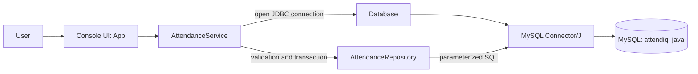
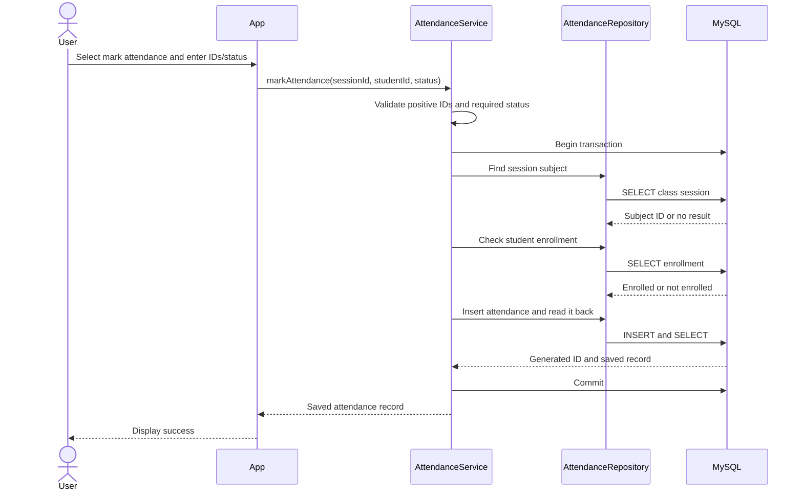
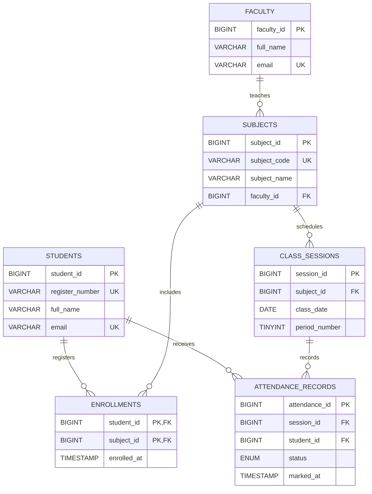

# AttendIQ Java Attendance

A console-based attendance MVP built with Java 25, JDBC, and MySQL. It validates that a class session exists and that the student is enrolled before recording attendance. The current application supports creating and retrieving attendance records; it does not yet provide full CRUD for every database entity.

## Technology Stack

| Area | Technology |
| --- | --- |
| Application language | Java 25 LTS |
| Database language | SQL |
| Database | MySQL 8 or newer |
| Database access | JDBC with MySQL Connector/J 9.4.0 |
| Build | Apache Maven 3.9 or newer |
| Command shell examples | Windows PowerShell |

The project targets Java 25 through `maven.compiler.release`. VS Code with the Extension Pack for Java is optional.

## Architecture

The console application delegates workflow and validation to a service. The service opens the transaction and calls the repository, which performs parameterized SQL operations over JDBC.



### Mark Attendance Flow



If validation or a database operation fails, the service rolls back the transaction. MySQL also enforces a unique `(session_id, student_id)` pair, preventing duplicate marks for a session.

## Data Model



`ENROLLMENTS` uses `(student_id, subject_id)` as a composite primary key. A class session is unique per subject, date, and period. Attendance status is restricted to `PRESENT`, `ABSENT`, or `ON_DUTY`.

## CRUD Operations

CRUD means Create, Read, Update, and Delete. This table describes operations available in the Java application, not just tables present in the schema.

| Entity | Create | Read | Update | Delete |
| --- | --- | --- | --- | --- |
| Attendance | Implemented: mark a student present, absent, or on duty | Implemented: retrieve by session ID and student ID | Not implemented | Not implemented |
| Student | Not implemented in the app; demo row is seeded by SQL | Not implemented | Not implemented | Not implemented |
| Faculty | Not implemented in the app; demo row is seeded by SQL | Not implemented | Not implemented | Not implemented |
| Subject | Not implemented in the app; demo row is seeded by SQL | Not implemented | Not implemented | Not implemented |
| Enrollment | Not implemented in the app; demo relation is seeded by SQL | Used internally to validate marking | Not implemented | Not implemented |
| Class session | Not implemented in the app; demo session is seeded by SQL | Used internally to validate marking | Not implemented | Not implemented |

The attendance workflow is exposed through `AttendanceService.markAttendance()` and `AttendanceService.getAttendance()`. Student, faculty, subject, enrollment, and class-session management menus and service methods remain future work.

## Project Layout

```text
java-attendance/
|-- pom.xml
|-- README.md
|-- src/
|   |-- main/
|       |-- java/com/attendiq/
|       |   |-- App.java
|       |   |-- AttendanceRecord.java
|       |   |-- AttendanceRepository.java
|       |   |-- AttendanceService.java
|       |   |-- AttendanceStatus.java
|       |   `-- Database.java
|       `-- resources/schema.sql
`-- .gitignore
```

## Requirements

- JDK 25 or newer
- Maven 3.9 or newer
- MySQL 8 or newer
- MySQL Workbench (optional; used below to run the schema script)

## Setup and Run (Windows PowerShell)

### 1. Create the schema and demo records

In MySQL Workbench, open `src/main/resources/schema.sql` and execute the script. It creates the `attendiq_java` database, six tables, and demo records:

| Record | Demo ID/value |
| --- | --- |
| Student | ID `1`, register number `REC26CS001` |
| Faculty | ID `1` |
| Subject | ID `1`, code `CS23333` |
| Enrollment | Student `1` in subject `1` |
| Class session | ID `1`, current date, period `1` |

If those IDs already belong to different records, use a fresh development database or adjust the demo data before testing.

### 2. Set Java, Maven, and database settings

Run these commands in the PowerShell terminal from which you will launch Maven. Replace the database password locally; do not commit it or paste it into chat.

```powershell
Set-Location "$HOME\Downloads\AttendIQ-java-attendance-starter\java-attendance"
$env:JAVA_HOME = 'C:\Program Files\Java\jdk-25.0.4.1'
$env:Path = "$env:JAVA_HOME\bin;$HOME\.maven\maven-3.9.15\bin;$env:Path"

$env:ATTENDIQ_DB_URL = 'jdbc:mysql://localhost:3306/attendiq_java?useSSL=false&allowPublicKeyRetrieval=true&serverTimezone=UTC'
$env:ATTENDIQ_DB_USER = 'root'
$env:ATTENDIQ_DB_PASSWORD = 'YOUR_MYSQL_PASSWORD'
```

The `allowPublicKeyRetrieval=true` URL option is included for local development with non-TLS MySQL authentication. Prefer TLS with certificate verification for remote or production database connections. If the MySQL account has no password, set `ATTENDIQ_DB_PASSWORD` to an empty string.

These environment variables apply only to the current PowerShell session. Set them again in a new terminal.

### 3. Build and launch

```powershell
mvn clean verify
mvn exec:java
```

The application menu offers:

1. **Mark attendance**: enter session ID `1`, student ID `1`, and status `1` (`PRESENT`), `2` (`ABSENT`), or `3` (`ON_DUTY`).
2. **Retrieve attendance record**: enter the session and student IDs.
0. **Exit**.

Marking the same student twice for one session should be rejected by the unique database constraint.

## Validation and Security Notes

- `mvn clean verify` compiles the application and runs the Maven test lifecycle. There are currently no automated test sources, so Maven reports no tests to run.
- JDBC statements use `PreparedStatement` parameters rather than interpolating user values into SQL.
- Database credentials are read from environment variables by `Database`; never hard-code or commit real credentials.
- This is an educational MVP. It has no login, faculty authorization, student/subject maintenance screens, attendance updates/deletes, reporting, or GUI. Do not expose it to real users until authentication, authorization, validation, and operational security are added.

## Troubleshooting

- **`Public Key Retrieval is not allowed`**: for local non-TLS development, confirm the JDBC URL includes `allowPublicKeyRetrieval=true`. For production, configure TLS instead.
- **`Access denied for user`**: confirm MySQL is running and that `ATTENDIQ_DB_USER` and `ATTENDIQ_DB_PASSWORD` match the MySQL account. Workbench does not normally reveal a saved password; reset the account if it is forgotten.
- **Session or student not found / not enrolled**: run the demo SQL and verify the selected IDs and enrollment in the `attendiq_java` database.

## Concepts Demonstrated

- Separation of concerns between console UI, service, repository, and database connection management.
- Validation and transaction rollback in the service layer.
- `AttendanceStatus` enum and immutable `AttendanceRecord` record.
- JDBC connections, prepared statements, result sets, and generated keys.
- Relational primary keys, foreign keys, composite keys, check constraints, and uniqueness constraints.
