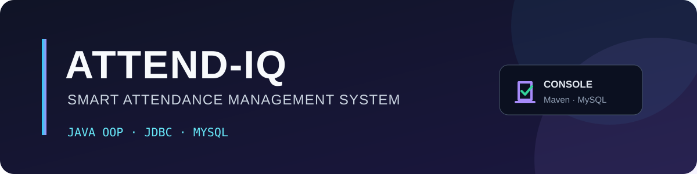
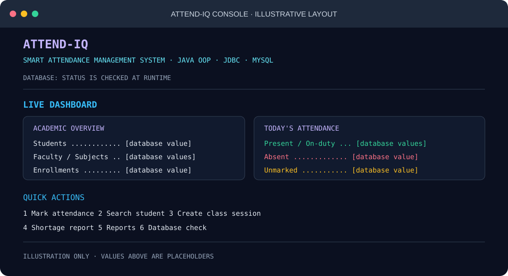
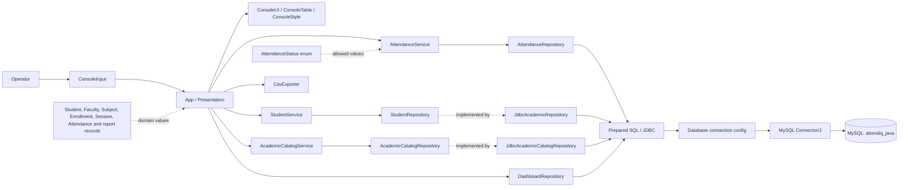
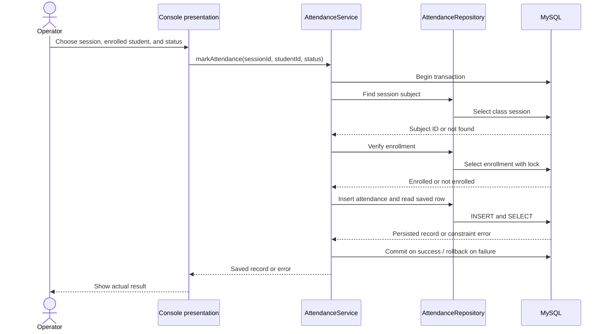

# Attend-IQ

<p align="center">
  
</p>

<p align="center">
  <a href="https://github.com/vishweshwaranbalasundaram/Attend-IQ/actions/workflows/verify.yml"></a>
  
  
  
  
  
  
  
</p>

**A database-backed attendance management system built as a Java console application.** Attend-IQ demonstrates Java OOP, JDBC, SQL, and MySQL through an academic workflow with colored terminal navigation. It has no web frontend or GUI.

**Project guide:** [Architecture](docs/ARCHITECTURE.md) | [Database schema](docs/DATABASE_SCHEMA.md) | [User guide](docs/USER_GUIDE.md) | [Testing](docs/TESTING.md) | [Project report](docs/PROJECT_REPORT.md) | [Demo script](docs/DEMO_SCRIPT.md) | [Viva questions](docs/VIVA_QUESTIONS.md)

## Project Overview

Manual attendance can be slow to reconcile and can result in duplicate marks or marks for students who are not enrolled in a class. Attend-IQ models the workflow in a relational database and validates the class session and student enrollment before saving attendance.

### Objectives

- Demonstrate Java object-oriented design, JDBC connectivity, SQL, and MySQL persistence.
- Provide console CRUD workflows for students, faculty, subjects, enrollments, and class sessions.
- Record and report attendance with database constraints and service-level validation.
- Keep the project understandable and demonstrable as a college OOP and DBMS project.

## Technology Stack

| Technology | Role in this project |
| --- | --- |
| Java 25 | Console application, services, domain records, validation, and transactions |
| Apache Maven 3.9+ | Dependency management, compilation, tests, packaging, and execution |
| JDBC / MySQL Connector/J 9.4.0 | Java database connectivity and prepared SQL statements |
| MySQL 8+ | Persistent relational data, keys, constraints, and attendance history |
| JUnit 5.11.4 | Unit and opt-in MySQL integration tests |
| JaCoCo 0.8.14 | Maven line-coverage reports; CI targets 70% aggregate coverage for service classes |
| Git and GitHub | Source control and repository verification workflow |

The repository does not publish language-percentage figures; no verified GitHub language breakdown was captured for this README. Technology badges describe the configured stack, not source-code distribution.

## Feature Overview

| Area | Implemented capabilities |
| --- | --- |
| Students | Create, list, view, update, delete when history permits, and search by name or registration prefix |
| Faculty | Create, list, view, update, delete subject to foreign keys, and list assigned subjects |
| Subjects | Create, list, view, update, and delete when enrollment/session history permits |
| Enrollments | Enroll/remove students and list relationships by student or subject |
| Class sessions | Create, list, view, update/delete before attendance exists, and filter by subject/date range |
| Attendance | Mark PRESENT, ABSENT, or ON_DUTY; retrieve by session, student, or subject/date range |
| Bulk attendance | Preview a subject roster and proposed marks; skip existing rows and report per-row results |
| Corrections | Correct/delete with a reason and an assigned-faculty check; retain attendance audit events |
| Reports | Student/subject percentage, subject summaries, shortage forecast, and attendance history filters |
| Dashboard | Database-backed totals, today's roster status, below-target count, and recent attendance audit activity |
| CSV export | Export students, filtered attendance, subject summaries, and shortage reports with overwrite confirmation |
| System diagnostics | Test a JDBC connection and inspect Java/database information without displaying credentials |
| Console UI | ANSI colors with a no-color option, responsive panels/tables, pagination, and progress bars |

These workflows demonstrate CRUD, validation, JDBC, SQL constraints, transaction handling, exception handling, and separation of presentation, service, and persistence responsibilities.

## Console Preview

This is an **illustrative terminal mockup**, not a screenshot of a live application session. Placeholder labels are used instead of fabricated database values. The application reads dashboard figures from the configured MySQL database.

<p align="center">
  
</p>

## Project Health and Live Status

The workflow badge at the top reflects the GitHub Actions Maven verification workflow. It runs on pushes, pull requests, and manual dispatch; it starts a disposable MySQL 8.4 service and runs the MySQL integration test against the isolated `attendiq_java_test` database. No remote workflow result is claimed here until GitHub records a run.

The last recorded local Maven verification on **2026-10-19** predates the authentication and coverage changes. The current build must be verified with `mvn clean verify`; a CI pass is claimed only after GitHub Actions completes successfully.

## Architecture



`App` and the console helpers collect input and render output. Services enforce use-case rules and coordinate multi-step operations. Repository interfaces define persistence operations, and JDBC implementations own SQL. Domain records carry returned values; the enum restricts attendance status. `Database` reads connection settings from environment variables.

## Attendance Marking Workflow



The service checks that the session exists and the student is enrolled. MySQL enforces the unique `(session_id, student_id)` attendance key, including concurrent duplicate attempts. A success message follows the successful commit.

## Database ER Diagram


`ENROLLMENTS` has a composite `(student_id, subject_id)` primary key. Class sessions are unique per subject/date/period; attendance is unique per session/student. The full table and migration details are in [DATABASE_SCHEMA.md](docs/DATABASE_SCHEMA.md).

## Database Integrity and Security

- JDBC values are bound with `PreparedStatement`; database resources use try-with-resources.
- Primary/foreign keys, unique identifiers, an enrollment composite key, session schedule uniqueness, and attendance uniqueness protect relational integrity.
- Attendance marking and audited corrections/deletions use transactions with rollback on failure.
- Existing enrollment and attendance history protects records from unsafe deletion. The application does not drop or reset user data.
- Database credentials come from `ATTENDIQ_DB_URL`, `ATTENDIQ_DB_USER`, and `ATTENDIQ_DB_PASSWORD`; the password is never printed.
- Attendance correction/deletion checks the assigned faculty ID and verifies its salted PBKDF2 password hash. New faculty accounts set a password when created; configured accounts must authenticate before changing it.
- Five failed logins lock an account for five minutes. Successful, failed, and locked login events are recorded without passwords in `faculty_auth_audit_log`.
- Attendance events remain in `attendance_audit_log`; catalog edits and failed attendance authorization attempts are not audited.

## Project Structure

```text
java-attendance/
|-- ../.github/workflows/verify.yml
|-- database/migrations/            # V2 search index through V5 login security
|-- docker-compose.yml              # MySQL only; initializes the schema on first start
|-- docs/                           # architecture, schema, user and project guides
|   `-- assets/                     # repository-owned SVG banner and preview
|-- src/main/java/com/attendiq/     # console, services, domain, JDBC repositories
|-- src/main/resources/schema.sql
|-- src/test/java/com/attendiq/     # unit and opt-in MySQL integration tests
|-- src/test/resources/schema-test.sql
|-- pom.xml
`-- README.md
```

## Prerequisites

- JDK 25 or newer
- Apache Maven 3.9 or newer
- MySQL 8 or newer
- MySQL Workbench (optional; used in the examples to run SQL scripts)
- Docker Compose (optional; starts only MySQL and initializes the schema)

## Install and Configure (Windows PowerShell)

### 1. Prepare the database

For a fresh local database, open `src/main/resources/schema.sql` in MySQL Workbench and execute it. The script creates `attendiq_java`, the application tables, migration tracking, and optional demo rows. It uses `CREATE TABLE IF NOT EXISTS` and `INSERT IGNORE`; it does not drop tables or reset existing rows.

For an existing V1 database, back it up and apply V2, V3, V4, and V5 in order from `database/migrations/`. The System menu never performs migrations automatically.

### 2. Set Java, Maven, and database configuration

Run these commands in the PowerShell window from which you will launch the application. Adjust `JAVA_HOME` and the project path to match your installation. Set the MySQL password locally; do not commit or share it.

```powershell
Set-Location "$HOME\Downloads\AttendIQ-java-attendance-starter\java-attendance"
$env:JAVA_HOME = 'C:\Program Files\Java\jdk-25.0.4.1'
$env:Path = "$env:JAVA_HOME\bin;$HOME\.maven\maven-3.9.15\bin;$env:Path"

$env:ATTENDIQ_DB_URL = 'jdbc:mysql://localhost:3306/attendiq_java?useSSL=false&allowPublicKeyRetrieval=true&serverTimezone=UTC'
$env:ATTENDIQ_DB_USER = 'root'
$env:ATTENDIQ_DB_PASSWORD = 'YOUR_MYSQL_PASSWORD'
$env:ATTENDIQ_ATTENDANCE_TARGET = '75'
$env:ATTENDIQ_COLOR = 'always' # use 'never' for plain output; omit for auto-detection
```

The URL option `allowPublicKeyRetrieval=true` is included for local development with non-TLS MySQL authentication. Prefer TLS with certificate verification for remote or production database connections. If the local MySQL account has no password, set the password variable to an empty string. These environment variables apply only to the current PowerShell session.

To start only the local MySQL service instead of installing MySQL directly, set a local password with `$env:ATTENDIQ_DB_PASSWORD = Read-Host 'Local MySQL password'`, then run `docker compose up -d mysql`. The schema is loaded only when the named data volume is first initialized. `docker compose down` stops MySQL; `docker compose down -v` also deletes its data volume.

New faculty set an initial password from Faculty Management. A trusted administrator can initialize a legacy/null-hash faculty account from the Set/change faculty password menu by setting `ATTENDIQ_ALLOW_INITIAL_PASSWORD_SETUP=true` for that setup session, then removing it afterward. Accounts with a configured password must authenticate with the current password before changing it.

## Build, Test, and Run

```powershell
mvn clean verify
mvn exec:java
```

`mvn clean verify` compiles production and test sources, runs unit tests, and writes a JaCoCo report. `mvn exec:java` starts `com.attendiq.App`. MySQL integration tests are opt-in locally and run in GitHub Actions; details are in [TESTING.md](docs/TESTING.md).

## Main Menu and Usage

| Choice | Module |
| --- | --- |
| 1 | Dashboard and quick actions |
| 2 | Student Management |
| 3 | Faculty Management |
| 4 | Subject Management |
| 5 | Enrollment Management |
| 6 | Class Session Management |
| 7 | Attendance Management, including bulk marking and correction |
| 8 | Reports & Analytics |
| 9 | CSV exports |
| 10 | System & Database diagnostics |
| 11 | Help & Shortcuts |
| 0 | Exit (`12` is also accepted for compatibility) |

Submenus use `0` to return. The dashboard quick-action prompt can also be skipped with `0`. Tables page results at 12 rows; press Enter for the next page or `q` to stop. Color detection supports Windows Terminal and VS Code terminals; `ATTENDIQ_COLOR=always` forces ANSI output, while `ATTENDIQ_COLOR=never` or `NO_COLOR=1` disables it.

## Attendance Calculation and Reporting Policy

For one student and subject, the report counts scheduled sessions from the enrollment date through today. `PRESENT` and `ON_DUTY` count as attended. `ABSENT` and unmarked scheduled sessions do not count as attended; unmarked sessions are shown separately and remain in the denominator.

```text
percentage = 100 * (present + on-duty) / scheduled sessions
```

With no scheduled sessions, the result is `0%` with an explanatory message. The shortage forecast finds the smallest `x` for which `(attended + x) / (scheduled + x) >= target / 100`. The default target is 75%; `ATTENDIQ_ATTENDANCE_TARGET` accepts an integer from 1 to 100. If the target is 100% and an absence already exists, the forecast is unreachable.

Dashboard totals are queried from MySQL. Today's rate uses attended marks divided by the enrolled roster expected for sessions today. The below-target number counts enrolled student/subject pairs below the configured threshold. Recent activity is read from the attendance audit table.

## Automated Testing

Unit tests cover service validation, attendance calculations, console input/rendering, CSV escaping, bulk-result handling, password hashing, and fake-clock login lockout. MySQL integration tests cover persistence, faculty authentication, lockout persistence, and password-free auth auditing in a dedicated `attendiq_java_test` database created from `src/test/resources/schema-test.sql`. Never point them at a personal or production database.

The last local verification recorded on **2026-10-19** predates the faculty authentication and CI changes. Run `mvn clean verify` to reproduce the unit suite; GitHub Actions also runs the integration test against MySQL 8.4. See [TESTING.md](docs/TESTING.md) for details.

## Documentation

- [Architecture and OOP design](docs/ARCHITECTURE.md)
- [Database tables, constraints, and migrations](docs/DATABASE_SCHEMA.md)
- [User guide and troubleshooting](docs/USER_GUIDE.md)
- [Testing and integration-test safety](docs/TESTING.md)
- [Academic project report](docs/PROJECT_REPORT.md)
- [Demonstration walkthrough](docs/DEMO_SCRIPT.md)
- [Viva questions and answers](docs/VIVA_QUESTIONS.md)

## Known Limitations

- Faculty password setup for legacy accounts requires a trusted setup session; this is a local console login, not a centralized identity service.
- Attendance audit history does not cover catalog edits or failed attendance-authorization attempts.
- Local MySQL integration tests need a separately configured `_test` database; GitHub Actions provisions one automatically.
- The application is a local console program; it has no hosted service, web API, frontend, or online attendance dashboard.
- There is no automatic schema migration runner; migrations must be applied manually after backing up the database.

## Academic Learning Outcomes

- **OOP:** encapsulation and composition in services; repository interfaces show abstraction and polymorphic implementations; records/enums model domain data. Inheritance is not forced where no useful is-a relationship exists.
- **DBMS:** normalized relationships, primary/foreign/composite keys, uniqueness, and referential integrity.
- **JDBC:** connections, prepared statements, result sets, generated keys, transaction commit, and rollback.
- **Software design:** layered responsibilities, input validation, exception handling, testable services, and database-backed reports.

## Contributing

For a change, create a focused branch, preserve the console/JDBC/MySQL architecture, and update documentation when user-visible behavior changes. Run `mvn clean verify` before opening a pull request. Do not include credentials, personal attendance data, generated exports, or changes that reset a development database.

## License

No license file is currently present in this repository. No open-source license is claimed by this README.

## Acknowledgements

The project uses Apache Maven, MySQL Connector/J, and JUnit 5; dependency versions are maintained in `pom.xml`.
