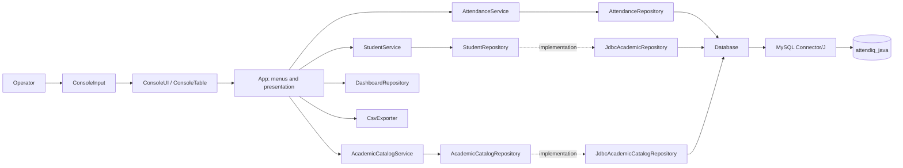
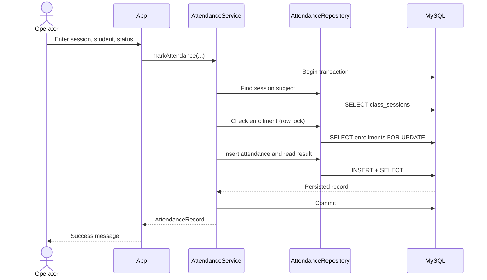

# Attend-IQ Core Architecture

## Scope

Attend-IQ Core is a Java 25 console application using Maven, JDBC, and MySQL. This repository edition is console-only: it contains no web API, Spring Boot application, frontend, or GUI.

## Layers

### Presentation

- `App` renders numbered menus, prompts for values, and displays results.
- `ConsoleInput` parses text, integer, long, and ISO date input and reports malformed input as an application-level validation error.
- `ConsoleStyle`, `ConsoleUI`, and `ConsoleTable` render ANSI/no-color messages, responsive tables, panels, progress bars, and confirmations.
- `CsvExporter` writes UTF-8 CSV with escaping and refuses overwrite unless the operator confirms.
- `DashboardRepository` gets inventory, today's attendance, shortage counts, and recent audit rows from MySQL; query failures are shown as errors, not zero values.

### Service

- `AttendanceService` enforces positive IDs/status, verifies session and enrollment, and coordinates attendance/audit transactions.
- `StudentService` validates student fields and delegates persistence through `StudentRepository`.
- `AcademicCatalogService` validates faculty, subject, enrollment, and class-session requests; it exposes attendance reports.

### Domain

Records model immutable returned values (`Student`, `Faculty`, `Subject`, `Enrollment`, `ClassSession`, `AttendanceRecord`, and report records). `AttendanceStatus` restricts attendance state to `PRESENT`, `ABSENT`, or `ON_DUTY`.

### Persistence

`AttendanceRepository`, `JdbcAcademicRepository`, and `JdbcAcademicCatalogRepository` contain JDBC and SQL. Input values are bound through `PreparedStatement`. Connections, statements, and result sets use try-with-resources. The database connection is configured through environment variables in `Database`.

## Attendance Write Transaction

Any failure in the workflow rolls the transaction back. The unique constraint on `(session_id, student_id)` is the final duplicate-prevention guard, including concurrent submissions.

## Bulk Attendance

Bulk marking previews a roster and confirmed statuses, then invokes `AttendanceService.markAttendance` independently per student. Each row commits or rolls back independently. Existing rows are skipped; a concurrent duplicate or database failure is included in the failed count. No existing attendance is silently overwritten.

## Audit and Export

V3 stores successful `MARKED`, `CORRECTED`, and `DELETED` attendance events atomically with attendance writes. Correction and deletion require the assigned faculty ID and a password verified against its salted PBKDF2 hash. V5 tracks failed logins, locks after five failures for five minutes, and writes password-free success/failure/lockout events to a separate authentication audit table. Catalog CRUD and failed attendance authorization attempts are not logged. CSV export uses the current database-backed service results and protects existing files unless overwrite is explicitly confirmed.

## Object-Oriented Concepts

- Encapsulation and composition: services hold repository contracts as private collaborators.
- Abstraction and polymorphism: `StudentRepository` and `AcademicCatalogRepository` are persistence contracts, implemented by JDBC classes.
- Records and enum: immutable model values and constrained attendance status.
- Inheritance: intentionally omitted because there is no meaningful is-a relationship in the current domain.
- Transaction coordination: services own business workflow; repositories own SQL.

## Authorization Boundary

Attendance correction/deletion verifies the faculty password and then compares that faculty ID with the faculty assigned to the session, while locking the session during the change. New faculty accounts receive a password during creation. Password changes require the current password; initial setup of legacy null-hash accounts is gated by `ATTENDIQ_ALLOW_INITIAL_PASSWORD_SETUP=true` for a trusted setup session. This remains a small console application's local login, not a production identity system.
