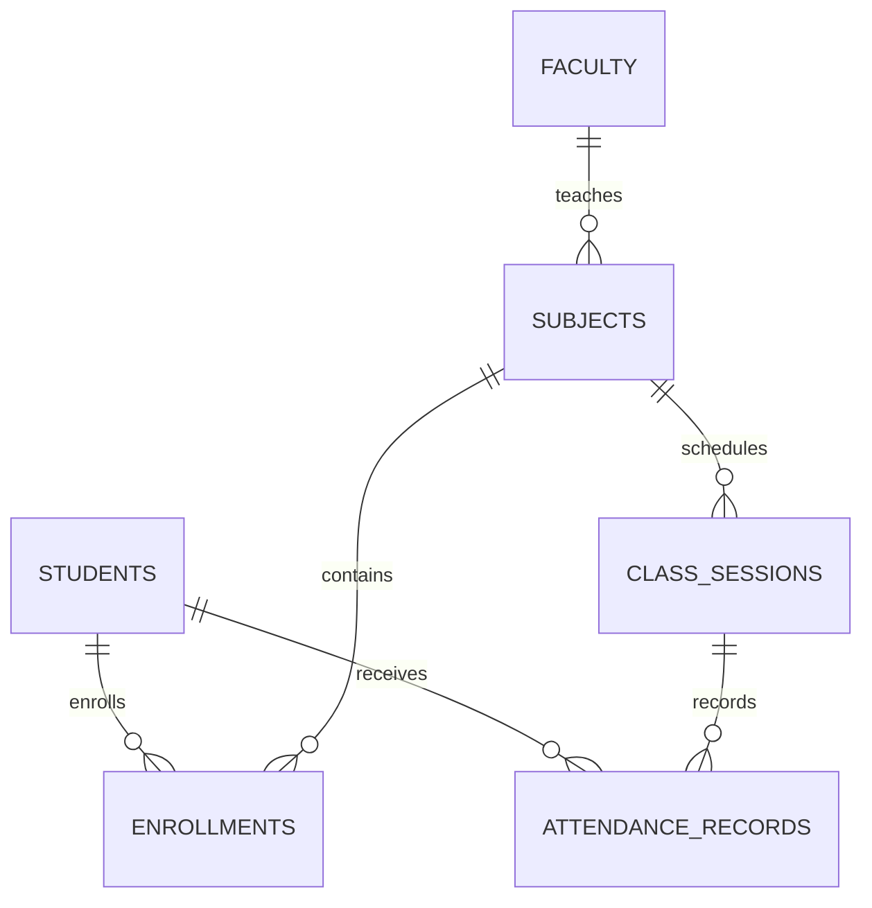

# Attend-IQ Core Database

## Database

Core connects to the MySQL database named `attendiq_java` by default. It uses the existing schema in `src/main/resources/schema.sql`; the optional incremental lookup-index migration is `database/migrations/V2__student_name_search_index.sql`.

## Entity Relationships

| Table | Main key | Important constraints |
| --- | --- | --- |
| `students` | `student_id` | Unique `register_number`; optional unique email |
| `faculty` | `faculty_id` | Required unique email |
| `subjects` | `subject_id` | Unique `subject_code`; FK to faculty |
| `enrollments` | `(student_id, subject_id)` | FKs to students and subjects; duplicate enrollment rejected |
| `class_sessions` | `session_id` | FK to subject; unique subject/date/period; period 1-12 |
| `attendance_records` | `attendance_id` | FKs to session and student; unique session/student; enum status |
| `attendance_audit_log` | `audit_id` | FKs to session/student/claimed faculty; event, old/new status, reason, timestamp |
| `schema_migrations` | `version` | Tracks manually applied Core migration versions |

## Data Preservation Rules

- Baseline schema creates seven application tables plus `schema_migrations` using `CREATE TABLE IF NOT EXISTS`; it never drops a table or deletes application rows.
- Demo rows use `INSERT IGNORE`; they do not overwrite existing rows.
- Student deletion is refused when an enrollment, attendance record, or audit row references the student.
- Enrollment removal is refused when attendance or audit history exists for that student and subject.
- Subject deletion is refused while enrollments or sessions exist.
- Session update/deletion is refused after attendance is recorded.
- Faculty deletion is rejected by the subject foreign key while subjects remain assigned.
- Attendance is removed only by an explicit action from the session's assigned faculty ID.
- Audit history prevents deletion of referenced sessions, students, faculty, or enrollments.
- Audit rows are retained after attendance deletion and prevent deletion of referenced sessions, students, or claimed faculty.

## Attendance Report Definition

The report includes sessions on/after enrollment and through the current date. `PRESENT` and `ON_DUTY` are counted as attended; `ABSENT` is counted as absent; a missing record is listed separately as unmarked and counts in the scheduled-session denominator.

`percentage = 100 * (present + on-duty) / scheduled sessions`

No sessions returns 0%, avoiding division by zero. The shortage forecast reports the smallest `x` satisfying `(attended + x) / (scheduled + x) >= target / 100`; a 100% target is impossible after a missed session.

## Fresh Setup

1. In MySQL Workbench, execute `src/main/resources/schema.sql` against the local MySQL server.
2. Set the Core JDBC URL/user/password environment variables in the terminal that will launch Maven.
3. Verify the menu's database connection test before managing data.

## Existing Database Migration

1. Back up the database before manual schema changes.
2. Confirm V1 baseline tables exist. Running `schema.sql` again is safe for table creation and seed rows, but it is not a general schema-diff engine.
3. Execute `database/migrations/V2__student_name_search_index.sql`; it creates missing lookup indexes by checking `information_schema` and records the migration.
4. Execute `database/migrations/V3__attendance_audit_log.sql` to add audit history for attendance changes.
5. Check `schema_migrations` and retain the backup until the new build is verified.

V3 records successful marks, corrections, and deletions in the same transaction as the attendance change. `claimed_faculty_id` is an entered value, not authenticated identity. Catalog edits and failed/unauthorized attempts are not logged.

For isolated integration tests, execute `src/test/resources/schema-test.sql` to create the separate `attendiq_java_test` schema. Never point test settings at the normal or production database.
